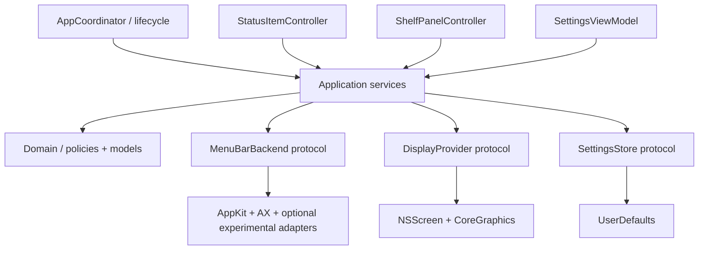

# Архитектура: Modular Monolith + Ports & Adapters

## Контекст
Одно приложение-user agent, без daemon/root/серверов. Системные API — через инфраструктурные адаптеры. UI знает только application state; доменная логика не зависит от AppKit.

## Модули
- **AppCoordinator**: boot, permissions, teardown, recovery orchestration; не содержит business rules.
- **MenuBarService**: актуальный snapshot значков, reconciliation, apply/revert; сериализованные операции.
- **MenuBarBackend**: capability negotiation `discover`, `hideSection`, `reveal`, `activate`, `restore`. Частичный support и явные ошибки.
- **DisplayService**: immutable snapshots, stable display matching heuristics, callbacks, active-target selection.
- **PanelCoordinator**: один лениво создаваемый `NSPanel`, position/clamp, состояние.
- **InteractionService**: hotkey, pointer zones, transient event monitors.
- **RulesEngine**: pure functions; белые/чёрные списки, new item decisions.
- **SettingsRepository**: migrations of schema, atomic writes where practical.
- **PermissionService**: request only when user starts feature; observer of TCC state.
- **DiagnosticsService**: opt-in diagnostics with redaction.

## Состояния панели
`closed -> opening -> open -> closing -> closed`; смена экрана из любого состояния отменяет переход и пересчитывает anchor. Не создавать очереди анимаций. Обработка повторных кликов идемпотентна.

## Потоки
**Startup:** load settings -> validate/migrate -> enumerate displays -> initialize status item -> assess capabilities -> ensure recovery -> optionally initialize panel.

**Click:** determine source display -> get current snapshot -> anchor panel -> render cached icons -> open -> activate underlying item via supported backend.

**Display change:** debounce reconfiguration (без бесконечного polling) -> snapshot -> invalidate geometry -> reanchor or dismiss -> restore focus.

**New icon:** receive hints (app launch/AX where available) -> reconcile snapshot -> apply pure rules -> request backend action only when permitted -> record outcome.

**Shutdown/crash:** attempt normal restore on orderly exit; after crash startup detects pending restore marker. Crash itself cannot guarantee execution of recovery code, hence use native separator fallback and persistent recovery workflow.

## Concurrency and ownership
- Все AppKit window/status-bar действия на `@MainActor`.
- System events delivered to a serial coordinator / actor; snapshots immutable.
- AX operations bound by latency budgets, run outside paint critical path as permitted by API/threading behavior.
- Use `[weak self]` in callbacks, remove observers/event taps on teardown.
- No retry storms; bounded exponential retry for transient system failures.

## Dependencies
Domain -> Foundation only. Application -> Domain protocols. Infrastructure -> AppKit/AX/CoreGraphics. Presentation -> Application view models. No circular dependencies.
